# 非常好用的待办管理工具DGT SODA

20250426更新：我写了一个更加更加详细的教程可以结合这篇文章一起看。完全按照图片结合注解的方式写的，真的想要了解软件的话可以看看

20240804 补充：

以下是很久以前做的关于DGT SODA的设置中的英文对应的中文意思，今天补上。

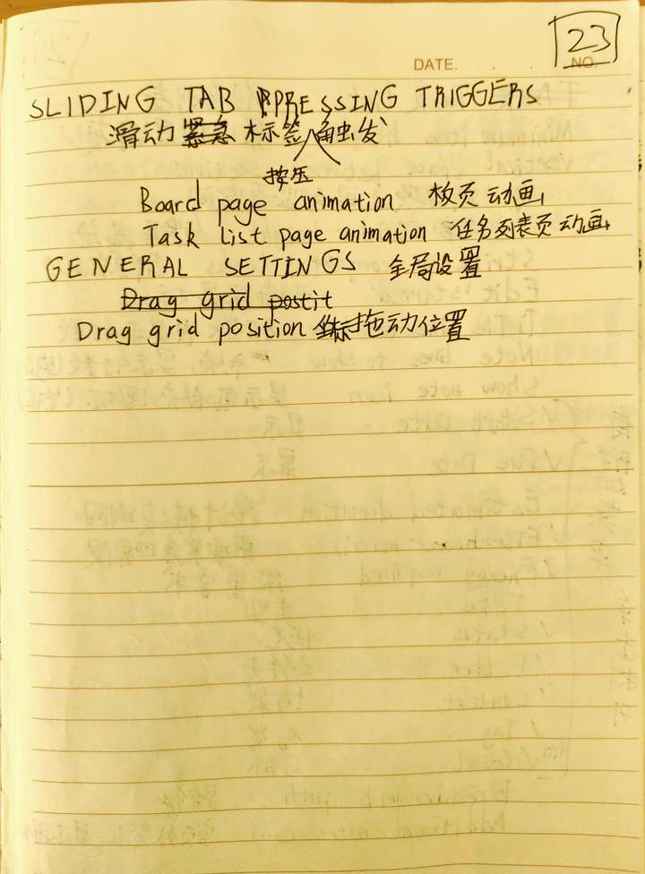

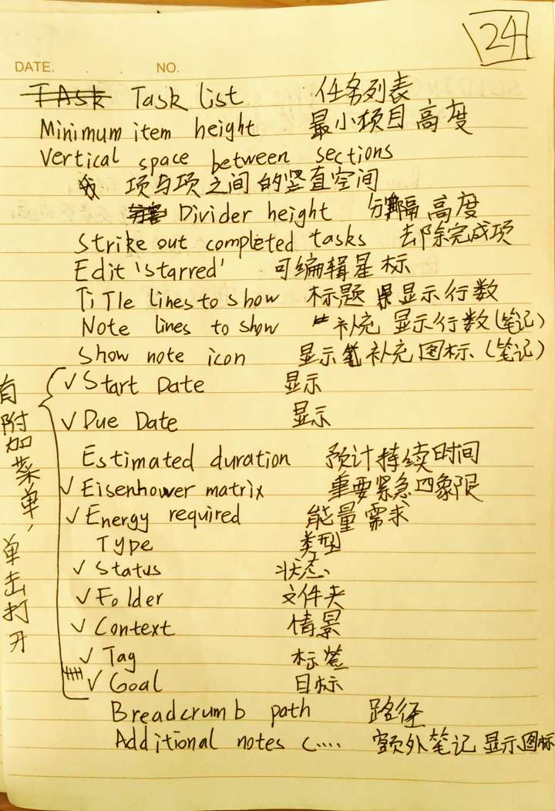

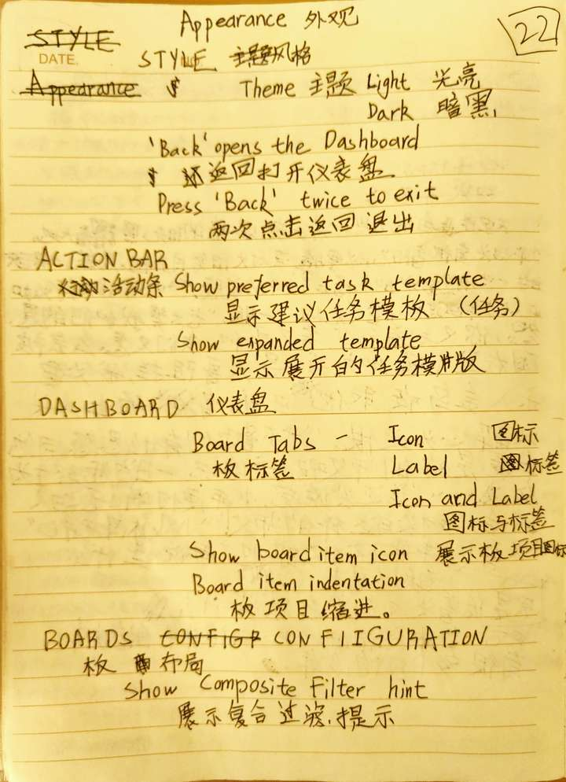

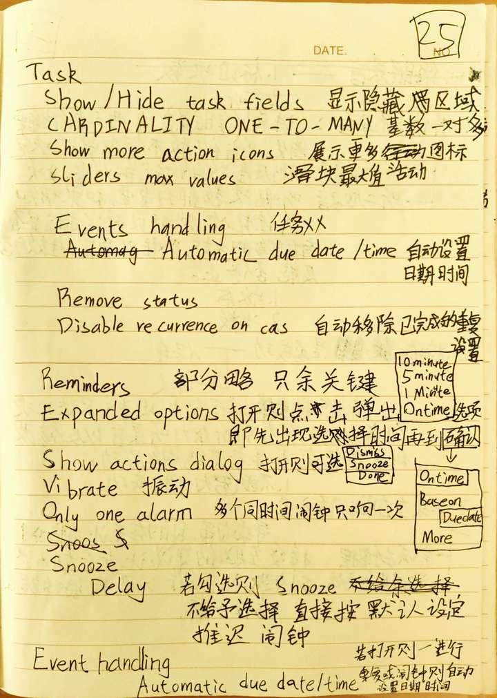

20230324 补充：

不要妄图使用所有的分类与功能，一开始先把想到的分类与属性设置完，正式使用一段时间后就开始精简，

把自己用不上的分类与属性删除，只保留符合自己个人特性的属性，这样才能保证自己不被过于繁琐的任务管理流程耽误时间。

我一开始使用了七八个面板的属性，结果越用越痛苦，管理任务的时间比实际完成任务的时间还要多，让我不堪重负，最终把使用的属性缩减为四个属性（日期、耗时、优先级、是否在队列中）才终于找到平衡，这四个属性是可以解决我的任务管理的痛点的最佳选择，我也不打算优化，下去了，正如一篇文章所说，系统不重要，生产力重要。

文章摘录如下，诸君，共勉：

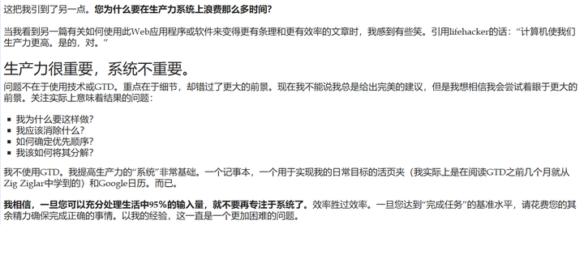

End 20230324

DGT SODA ，一个非常好用的APP，不仅好用而且免费，它的前身是DGT GTD ，虽然SODA很复杂，它自带无限层级，和自定义的过滤器，各种细致的分类列表，但是上手以后使用非常方便。

（多图预警）

DGT SODA是一个高度自定义的个人任务管理APP。

首先上图，看看默认的各个面板的合照：

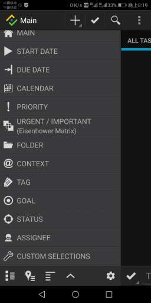

以及进入面板修改面板名称后的合照：

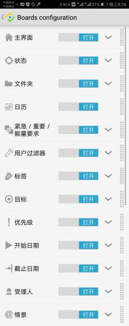

可能你有疑问，为什么图片样子不一样，答案是，后者是面板的编辑器，在这个界面你可以隐藏或显示任何一个面板，修改任何一个面板的名称。

所有面板的编辑器从这里进入

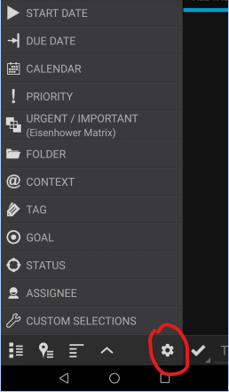

第一个，主面板：

原版：

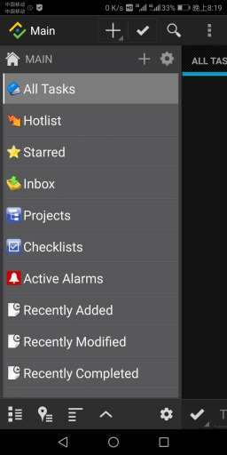

手动改名后的图片：

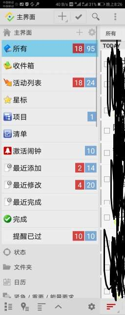

后者多出来的那个【提醒已过】是我自己添加的。

单个面板的编辑入口在此：

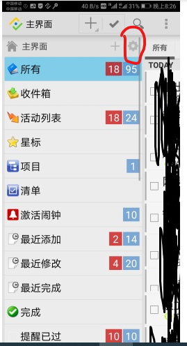

是的，每个面板都可以添加不同的条目，有的是高度自定义的条目，如下：

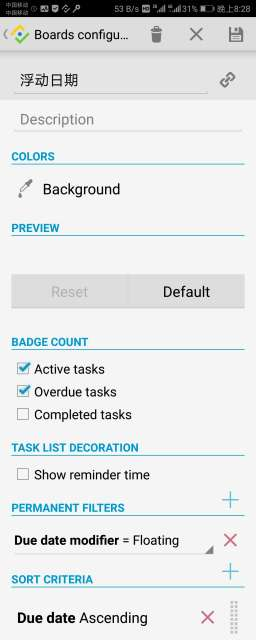

图中倒数第二个是过滤条件 【PERMANENT FILTERS】

图最后那个是排序条件 【SORT CRITERIA】

过滤条件是可以组合的，如下

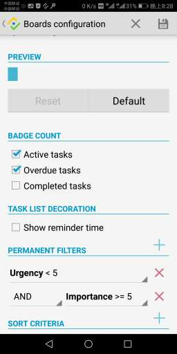

这个过滤条件的意思是： 同时满足紧急度小于5 与 重要性大于等于5的条目

排序条件也是可以组合的，在上面的排序条件优先于在下面的排序条件。

如图：

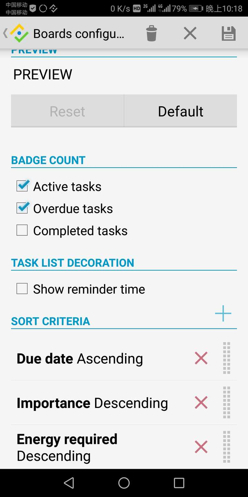

一个小提醒，DGT SODA中但凡有以下图标的都可以上下移动：

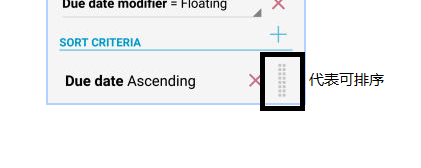

然后每个面板还有另一种条目则是无法自定义，如【文件夹】面板中就只能添加文件夹的名字，如图：

图中的【我的一天】【我的一周】就是无法自定义，只能自定义名称的条目。

至于添加单个条目的按钮，是这个：

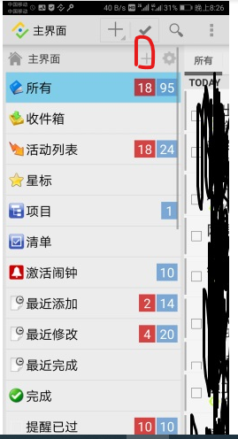

第二个，状态：

同样，英文原版：

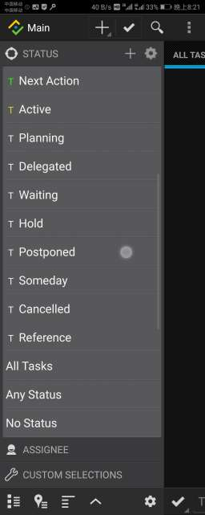

自定义修改的版本：

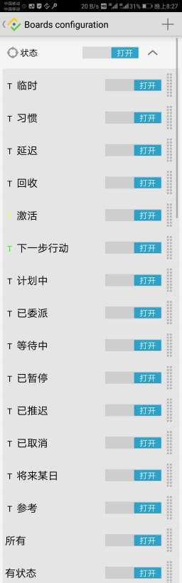

途中前面的4个（【临时】【习惯】【延迟】【回收】）是我自己添加的，属于不能自定义内容的条目。

必须提到的，添加的每个任务都可以设置不同的属性。

若所有属性都显示的话，新建任务的界面如下

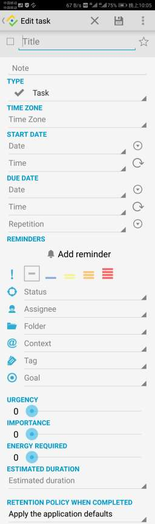

也可以是这样的：

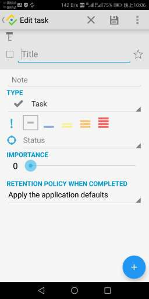

后者隐藏了部分属性，在设置里可以设置新建任务时所显示的属性，就在这里：

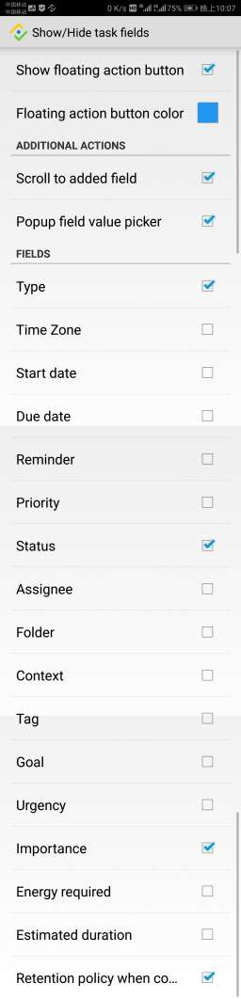

若是隐藏了相应属性又想添加那种属性怎么办？不怕，下图中的【+】就可以添加。

现在再提一下【状态】这个条目，它对应的是GTD中的下一步行动、项目、将来/或许等。

第三个，文件夹：

原图：

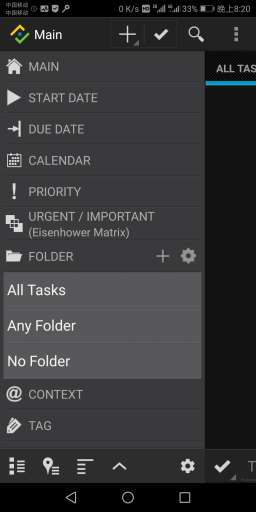

修改后：

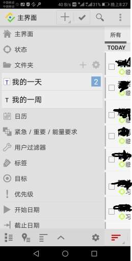

第四个，日历：

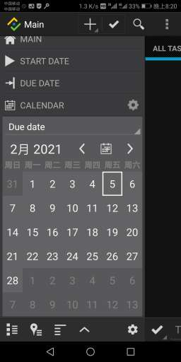

可以选择是开始日期的日历还是截止日期（到期日期）的日历。

图中对应的那天若是有一至四个任务，就会显示一至四个黑点，再多就显示一条黑线。

点击哪一天就在右侧显示哪一天的所有任务

截止日期：

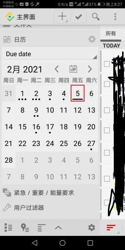

开始日期：

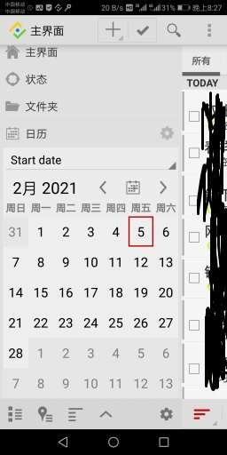

下一个，第五个，也就是所说的紧急重要四象限：

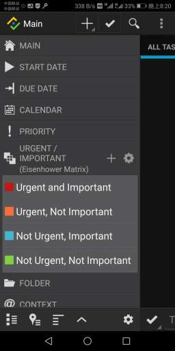

改后：

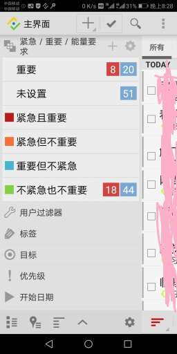

这个面板是可以添加自定义条目的，前面的第一个，【主界面】也可以添加自定义条目，至于第二个第三个，【状态】【文件夹】，则是只能添加不能自定义的条目。

第六个，用户过滤器，也就是自带的可以添加任意过滤条件也就是自定义条目的面板。

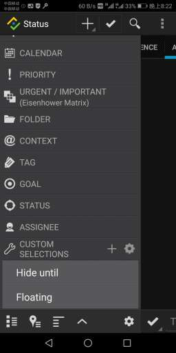

修改后的图片就不放了，忘了截图

其实自定义条目可以定制的属性是非常多的，如图：

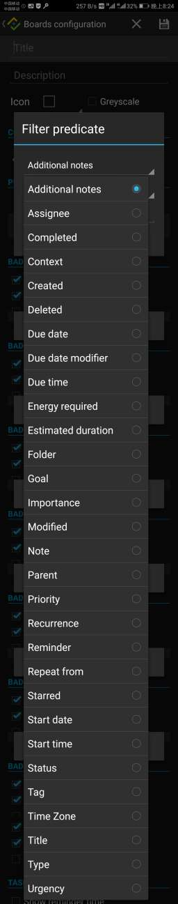

意思从上到下分别是：

额外笔记

受理人

完成

情景

创建

删除

截止日期

截止日期类型

截止时间

能量需求

重要紧急四象限

文件夹

目标

重要性

修改

笔记

父级

优先级

是否设置重复

提醒

以到期日期重复还是以完成日期重复

星标

开始日期

开始时间

状态

标签

时区

标题

类型

紧急度

第七个，标签：

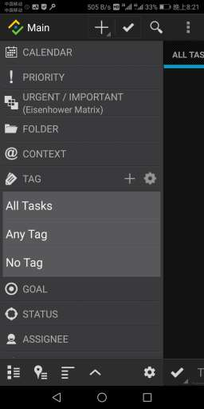

改后的图没有，忘了截图。

第八个，目标：

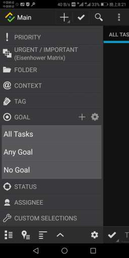

修改后的图片就不放了，忘了截图

第九个，优先级：

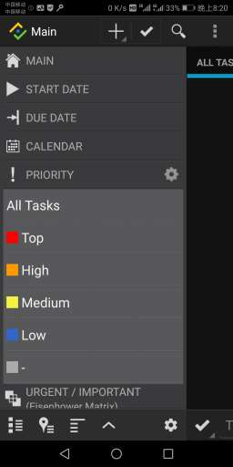

修改后的图片就不放了，忘了截图

第十个：开始日期：

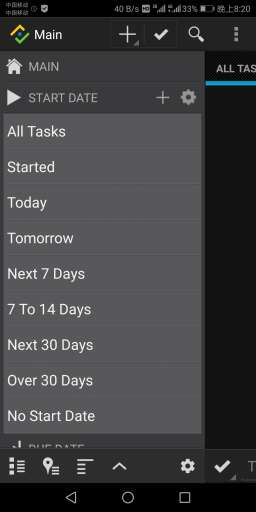

修改后的图片：

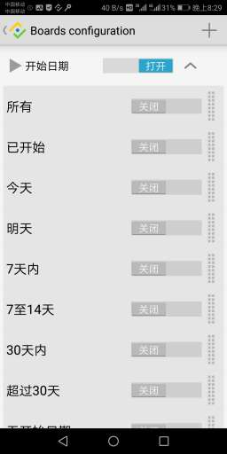

第十一个，截止日期：

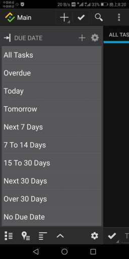

修改后的图片：

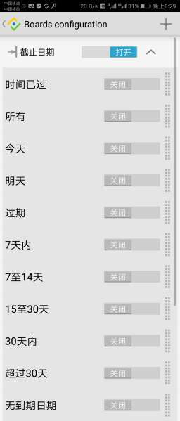

第十二个，受理人：

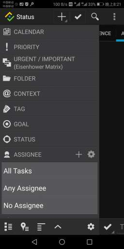

修改后的图片：

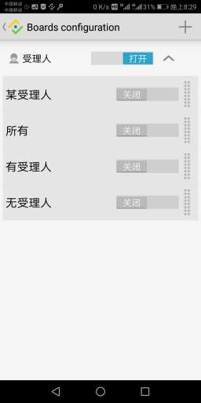

第十三个，情景：

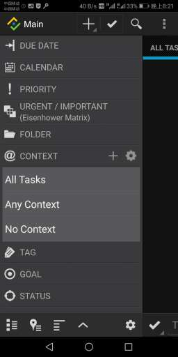

修改后的图片：

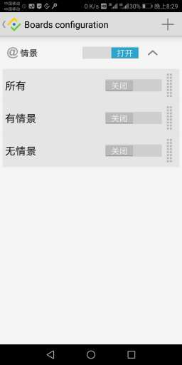

所有面板都介绍了一次，接下来要介绍其他东西了。

DGT SODA 的左边是上面的各个面板，而右边则是任务列表

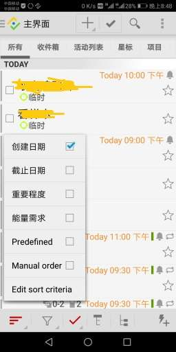

任务列表下方第一个是排序方式，点击【Edit sort criteria】就可以新建或删除或重命名排序方式

如下：

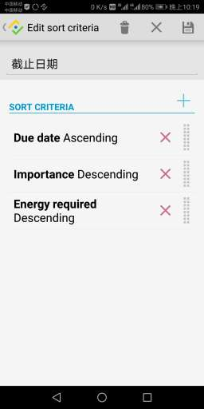

下方第二个则是过滤器，如图:

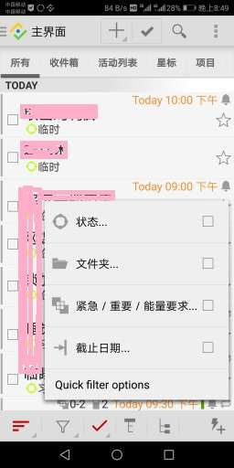

你可以 以任意面板中的条目作为筛选条件，筛选出符合条件的任务条目

如选中【截止日期】中的【已过期】与【今日】条目，筛选出符合条件的任务

下方第三个则是选择是否隐藏已完成任务，如下：

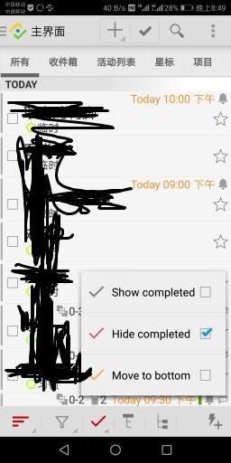

下方第四个则是隐藏父级

下方第五个则是隐藏子任务

下方第六个则是快速添加任务，如下图：

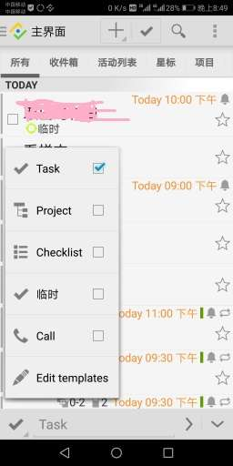

在这里可以选择好要添加的任务的类型，然后在横线里填入任务名，回车，即可新建任务

除此以外，新建任务可以设置模板，至于什么是模板，下面会提到。

在任务列表右上方，第一个是添加任务，如下图：

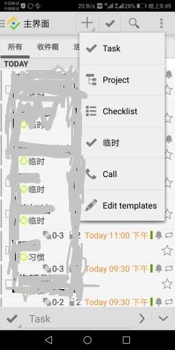

点击【Edit templates】,可以设置新建任务的模板，模板的意思就是，新建的任务都有与模板相同的属性。比如模板的属性是【状态】=【下一步行动】，【文件夹】=【我的一天】，则通过此模板新建的任务---->【状态】=【下一步行动】，【文件夹】=【我的一天】。

模板管理界面如下：

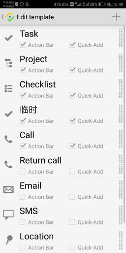

模板可以选择显示或隐藏

模板编辑界面如下：

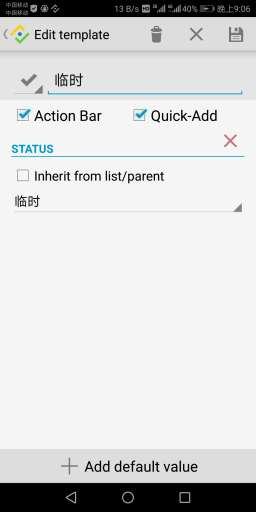

右上方第二个，则是快速添加任务，快速添加不带任何属性的任务

右上方第三个，则是搜索

右上方第四个，则是菜单，点击后出现的菜单如下：

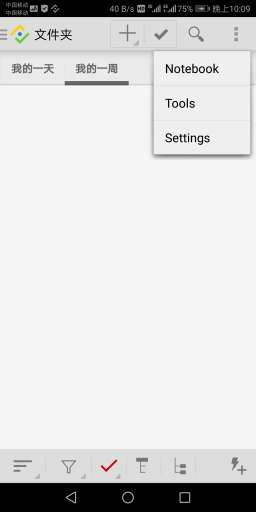

第一个是笔记本，下次修改再提

第二个是备份还原工具，点进去的界面如下：

此界面上面的是还原，下面的是备份。

可以设置自动备份，设置备份最多保留多少个备份文件，但要进设置里面才能更改

说回菜单，第三个是设置，点进去，出现如下界面：

全英文，且无法修改为中文，我一开始用的时候，是手打，一个一个的把不懂的单词打出来在必应词典里翻译，结合使用才弄明白的。

时间有限，设置就不一一介绍了。

其中，自定义在任务列表中显示哪个属性的设置在下图：

最后，提一下我说到的无限层级：

只要任务的类型设置为清单或者项目，就可以嵌套子任务，子清单，子项目。

虽说是无限层级，但太多层级的话会卡，建议不要设置太多的层级。

补充一句： 若是排序方式是默认即“Predefined”的话，任务是可以手动排序的，如上图，但是如果排序方式不对的话，就会变成这样，无法手动排序了。

变得无法排序。

